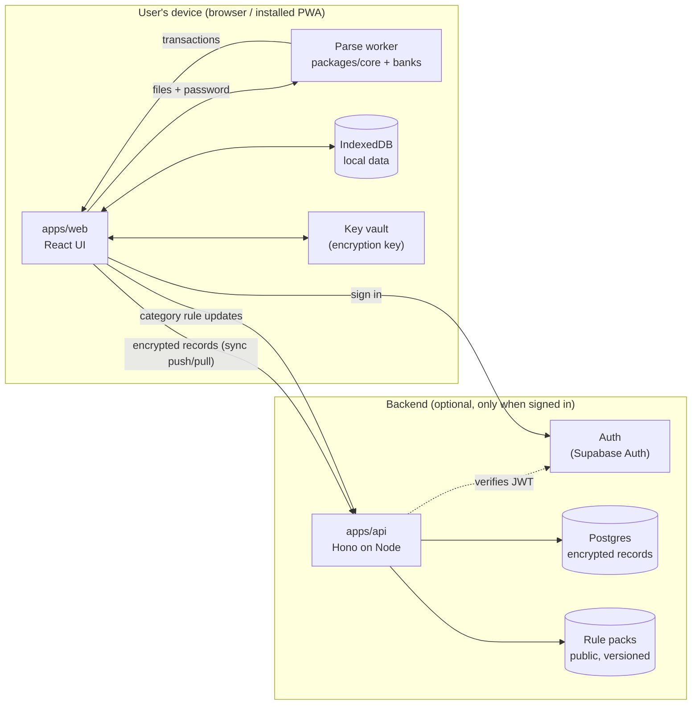

# Spend Lens — Architecture

Status: phase 1 done (15 Nov 26) · phases 2–5 proposed
Scope: how Spend Lens grows from one HTML file into a maintainable product with accounts, sync across devices, and a backend — without giving up its core promise that **your statements stay private**.

---

## 1. Principles

These decide every trade-off below.

1. **Private by design.** Statement files and PDF passwords never leave the device. Parsing happens in the browser. The server only ever stores data the user chose to sync, and stores it encrypted so the server itself can't read it.
2. **Local-first.** The app works fully offline and without an account, exactly like today. Signing in only adds sync and backup.
3. **One source of truth for logic.** Parsing, categorising and insights live in one pure TypeScript package used by the browser, tests and (where needed) the server. No logic is duplicated.
4. **Bank formats are plug-ins.** Each bank (HBL, Meezan, UBL, generic CSV…) is a small adapter with its own tests. Adding a bank never touches the core.
5. **Design system as code.** The tokens and rules already agreed (paper/ink, purple only for interactive things, Roboto Serif + Roboto, Phosphor icons, DD MMM YY dates, ≥12px text, ≥44px targets) live in one package and are enforced by lint and tests.
6. **Boring, well-supported tools.** TypeScript everywhere, one database (Postgres), managed hosting.

---

## 2. Where we are today

`spend-dashboard/index.html` (≈2,300 lines) holds everything: CSS, markup, and one script with these sections.

| Today's section (index.html) | What it does | Moves to |
|---|---|---|
| Styles + "HIG pass" overrides | Tokens, components, dark mode | `packages/ui/src/tokens`, component CSS |
| Icons | Phosphor name map | `packages/ui/src/icons` |
| Categories, Merchant cleanup | Keyword rules, merchant aliases | `packages/core/src/categorize` |
| Parsing helpers, Table parsing | Dates, amounts, CSV/XLSX column detection | `packages/core/src/parse` |
| PDF parsing (+ HBL quirks) | Text extraction, wrapped rows, de-duplication | `packages/core/src/parse/pdf` + `packages/banks/hbl` |
| Currency detection | Billing currency from file text | `packages/core/src/currency` |
| State & storage | IndexedDB + localStorage, start-up | `apps/web/src/data` (repository layer) |
| Formatting | Rs/lakh, DD MMM YY, labels | `packages/core/src/format` |
| Import | Queue, password prompt, notices | `apps/web/src/features/import` + parse worker |
| Derived data, Insights, Recurring | Totals, changes, notes | `packages/core/src/analytics` |
| Pages (Overview … Transactions) | Rendering, routing | `apps/web/src/pages/*` |
| Dialogs, tooltip, events | Confirm, password, upload | `packages/ui/src/components` |

This works, but every change touches one file, there are no automated tests outside the ones run by hand, and nothing can sync between devices.

---

## 3. Target architecture



**What stays on the device:** statement files, PDF passwords, the decryption key, all parsing and all analytics.
**What reaches the server (only if signed in):** encrypted records the server can't read, plus account and device metadata.

### Tech choices

| Layer | Choice | Why |
|---|---|---|
| Language | TypeScript (strict) | One language for web, worker, server, tests |
| Monorepo | pnpm workspaces + Turborepo | Shared packages, cached builds |
| Web app | React + Vite, TanStack Router, Zustand | Small, fast, works as a static site and PWA |
| Parsing | pdf.js, PapaParse, SheetJS in a Web Worker | Same libraries as today, off the main thread |
| Local storage | IndexedDB via `idb`, localStorage only for UI prefs | Today's model, behind one repository interface |
| API | Hono on Node (Vercel Functions or Fly.io) | Tiny, typed, runs on serverless or a container |
| Database | Postgres (Supabase) + Drizzle ORM migrations | Row-level security, managed backups |
| Auth | Supabase Auth (email magic link, Google) | No passwords stored by us; JWTs the API can verify |
| Validation | Zod schemas in `packages/contracts` | Same types on client and server |
| Tests | Vitest (unit), Playwright (end-to-end) | Fast, runs in CI |
| Hosting | Web on Vercel (static), API on Vercel/Fly, DB on Supabase | Managed, low ops |

---

## 4. Folder structure

```text
spend-lens/
├── apps/
│   ├── web/                              # The product UI (static site + PWA)
│   │   ├── index.html
│   │   ├── vite.config.ts
│   │   ├── public/
│   │   │   ├── manifest.webmanifest      # installable app
│   │   │   └── icons/
│   │   └── src/
│   │       ├── main.tsx                  # boot: render immediately, then hydrate from IndexedDB
│   │       ├── app/
│   │       │   ├── App.tsx               # shell: sidebar, header, tab bar
│   │       │   ├── router.tsx            # #/overview … #/transactions
│   │       │   └── providers.tsx         # store, i18n, error boundary
│   │       ├── pages/
│   │       │   ├── overview/             # story, figures, spectrum, widgets
│   │       │   ├── categories/           # list + category detail
│   │       │   ├── trends/               # stacked chart, category comparison, monthly totals
│   │       │   ├── merchants/
│   │       │   ├── insights/             # notes + recurring charges
│   │       │   ├── transactions/         # table, search, sort, re-categorise
│   │       │   └── welcome/              # empty state
│   │       ├── features/
│   │       │   ├── import/               # upload dialog, password prompt, import queue, notices
│   │       │   ├── statements/           # statement list, month labels, remove
│   │       │   ├── filters/              # period, category, currency switch
│   │       │   ├── export/               # CSV export (formula-safe)
│   │       │   └── account/              # sign in, devices, sync status, delete account
│   │       ├── workers/
│   │       │   └── parse.worker.ts       # runs packages/core + banks off the main thread
│   │       ├── data/
│   │       │   ├── repository.ts         # one interface: getAll, put, remove, subscribe
│   │       │   ├── idb.ts                # IndexedDB implementation (+ timeout, retry)
│   │       │   ├── migrations.ts         # local schema versions (v1 = today's spendlens.v1)
│   │       │   └── legacy-import.ts      # reads today's localStorage/IndexedDB data once
│   │       ├── sync/
│   │       │   ├── engine.ts             # push/pull loop, cursors, retries, offline queue
│   │       │   ├── crypto.ts             # key derivation, AES-GCM encrypt/decrypt
│   │       │   └── conflicts.ts          # last-write-wins per record + tombstones
│   │       ├── state/
│   │       │   └── store.ts              # Zustand: view, month, category, currency, search
│   │       └── styles/
│   │           └── global.css            # imports packages/ui tokens
│   │
│   └── api/                              # Backend (only used when signed in)
│       ├── src/
│       │   ├── index.ts                  # Hono app, middleware order
│       │   ├── env.ts                    # validated environment variables
│       │   ├── middleware/
│       │   │   ├── auth.ts               # verify Supabase JWT → userId
│       │   │   ├── rate-limit.ts
│       │   │   ├── size-limit.ts         # reject oversized bodies
│       │   │   └── request-id.ts         # logs carry an id, never payloads
│       │   ├── routes/
│       │   │   ├── health.ts             # GET /healthz
│       │   │   ├── me.ts                 # GET /v1/me
│       │   │   ├── sync.ts               # POST /v1/sync/push, GET /v1/sync/pull
│       │   │   ├── devices.ts            # GET/DELETE /v1/devices
│       │   │   ├── rules.ts              # GET /v1/rules/latest
│       │   │   └── account.ts            # GET /v1/account/export, DELETE /v1/account
│       │   ├── services/
│       │   │   ├── sync.service.ts       # versioning, idempotency, tombstones
│       │   │   ├── devices.service.ts
│       │   │   └── account.service.ts    # export + hard delete
│       │   └── jobs/
│       │       └── purge-tombstones.ts   # scheduled clean-up
│       └── test/
│
├── packages/
│   ├── core/                             # Pure TypeScript, no DOM, no network
│   │   └── src/
│   │       ├── model/                    # Transaction, Statement, Category, Override types
│   │       ├── parse/
│   │       │   ├── dates.ts              # DMY/MDY detection, real-date validation, year rollover
│   │       │   ├── amounts.ts            # CR/DR, brackets, signs
│   │       │   ├── table.ts              # CSV/XLSX header + column detection, Type column
│   │       │   ├── pdf.ts                # lines from pdf.js text, duplicate-glyph removal
│   │       │   └── normalize.ts          # sign normalisation, dedupe keys
│   │       ├── currency/detect.ts
│   │       ├── categorize/
│   │       │   ├── rules.ts              # keyword rules (from today's CATEGORIES)
│   │       │   ├── merchants.ts          # merchant clean-up + aliases
│   │       │   └── engine.ts             # rules + user overrides + rule packs
│   │       ├── analytics/
│   │       │   ├── totals.ts             # by month, category, merchant
│   │       │   ├── comparison.ts         # category month-on-month
│   │       │   ├── recurring.ts
│   │       │   ├── fx-fees.ts            # foreign-transaction cost
│   │       │   └── insights.ts           # plain-language notes
│   │       └── format/
│   │           ├── money.ts              # Rs lakh/crore, other currencies
│   │           ├── dates.ts              # DD MMM YY, MMM ’YY
│   │           └── statement-label.ts    # "Sep–Oct 26"
│   │
│   ├── banks/                            # One adapter per bank format
│   │   ├── src/
│   │   │   ├── adapter.ts                # interface: detect(text) → score, parse(input) → rows
│   │   │   ├── registry.ts
│   │   │   ├── hbl/                      # HBL credit card PDF (wrapped rows, FCY notes)
│   │   │   ├── generic-pdf/              # today's line-based fallback
│   │   │   └── generic-table/            # any CSV/XLSX with date/description/amount
│   │   └── fixtures/                     # SYNTHETIC statements only (see §8)
│   │
│   ├── contracts/                        # Zod schemas shared by web and api
│   │   └── src/{records,sync,rules,account}.ts
│   │
│   ├── ui/                               # Design system
│   │   └── src/
│   │       ├── tokens/                   # colours (light, dark-purple, high contrast), type, spacing
│   │       ├── icons/                    # Phosphor Regular map
│   │       ├── components/               # Button, Dialog, ConfirmDialog, Tooltip, Chip,
│   │       │                             # CategoryBadge, StackedChart, MiniBars, Ledger, Receipt
│   │       └── a11y/                     # focus trap, keyboard helpers
│   │
│   ├── db/                               # Database schema + migrations (Drizzle)
│   │   ├── schema.ts
│   │   ├── migrations/
│   │   └── policies.sql                  # row-level security
│   │
│   └── config/                           # shared tsconfig, eslint, prettier
│
├── e2e/                                  # Playwright: import, pages, refresh, sync
├── docs/
│   ├── ARCHITECTURE.md                   # this file
│   ├── DESIGN-RULES.md                   # the agreed visual rules
│   ├── adding-a-bank.md
│   └── security.md
├── .github/workflows/ci.yml              # lint, typecheck, test, e2e, deploy
├── turbo.json
├── pnpm-workspace.yaml
└── package.json
```

**Dependency rule:** `core` and `contracts` depend on nothing in the repo. `banks` depends on `core`. `ui` depends on `core` (for formatting only). `web` depends on everything above. `api` depends on `contracts` and `db` and never on `banks` (the server never parses statements).

---

## 5. Front end

**Start-up (keeps today's fix):** render the shell immediately from localStorage UI prefs, then hydrate data from IndexedDB with a 1.5 s timeout; never block first paint on storage.

**Import pipeline:**
1. The upload dialog collects files and an optional password.
2. Files go to `parse.worker.ts` one import at a time (queue).
3. The worker asks the bank registry which adapter fits, parses, detects currency, normalises signs, and returns transactions. Password prompts round-trip to the UI through messages; the password lives only in worker memory for that file (or in the device key vault if "Remember" is ticked).
4. The UI stores results through the repository, which also queues them for sync if signed in.

**State:** a small Zustand store for UI state (view, month, category, currency, search, sort). Data comes from the repository via subscriptions, so pages re-render when data changes, including after a sync pull.

**Routing:** hash routes as today (`#/overview` …) so the static build works from any host and from a file.

**Design system:** tokens and components in `packages/ui`. Lint rules block raw hex colours and font sizes under 12px outside tokens; a Playwright check asserts 44 px targets and 4.5:1 contrast on every page (the same checks run during the HIG audit).

---

## 6. Backend mechanism

### 6.1 What the backend is for

- Accounts and sign-in.
- **Encrypted sync** between a user's devices, and a backup if a browser is wiped.
- Distributing **category rule packs** (better merchant → category mappings) without shipping a new app.
- Account export and deletion.

The backend does **not** receive statement files, passwords or readable transactions.

### 6.2 End-to-end encryption

- At first sign-in on a device, the user sets a **sync passphrase** (separate from their login). A key is derived from it with PBKDF2-SHA-256 (600,000 iterations) via WebCrypto, or Argon2id if a WASM build is added later.
- That key wraps a random **data key** (AES-GCM 256). The wrapped data key is stored on the server; the passphrase and unwrapped key never are.
- Every record (transaction, statement, override, setting) is serialised, encrypted with the data key using a fresh 96-bit nonce, and uploaded as ciphertext.
- A one-time **recovery code** is shown at setup so the user can recover if they forget the passphrase. Without either, data on the server can't be decrypted, by design.
- New device: sign in → enter passphrase → download wrapped key → unwrap locally → pull records.

Trade-off: the server can't compute totals or send "you spent more this month" emails. Those stay on the device. If server-side features are wanted later, they become an explicit opt-in that uploads only the specific aggregates needed.

### 6.3 Data model (Postgres)

```sql
users        (id uuid pk = auth uid, created_at, wrapped_data_key bytea, kdf_salt bytea, kdf_params jsonb)
devices      (id uuid pk, user_id fk, name text, created_at, last_seen_at)
records      (id uuid pk,                       -- generated on the device
              user_id fk,
              kind text check (kind in ('statement','transaction','override','setting')),
              ciphertext bytea, nonce bytea,
              version bigint not null,            -- from a global sequence, drives sync cursors
              deleted boolean default false,      -- tombstone
              updated_at timestamptz,
              device_id fk)
rule_packs   (version int pk, published_at, rules jsonb)   -- public, not user data
audit_events (id, user_id, type, created_at)              -- sign-in, device added/removed, export, delete; no content
```

Indexes: `records(user_id, version)`, `devices(user_id)`.
Row-level security: every user table is readable and writable only where `user_id = auth.uid()`.

### 6.4 API (REST, JSON, `/v1`)

| Method | Path | Purpose |
|---|---|---|
| GET | `/healthz` | Liveness |
| GET | `/v1/me` | Account, key-wrapping params, devices count |
| PUT | `/v1/keys` | Store wrapped data key + KDF params (first setup / passphrase change) |
| POST | `/v1/sync/push` | Upload up to 500 changed records; idempotent by record id + client version |
| GET | `/v1/sync/pull?cursor=` | Records with `version > cursor`, paged, plus the next cursor |
| GET | `/v1/devices` · DELETE `/v1/devices/:id` | Manage signed-in devices |
| GET | `/v1/rules/latest?since=` | Newer category rule pack, if any |
| GET | `/v1/account/export` | All encrypted records (user decrypts locally) |
| DELETE | `/v1/account` | Hard delete of all rows; confirmation token required |

All bodies are validated with the shared Zod schemas. Requests are authenticated with the Supabase JWT (`Authorization: Bearer`). Limits: 1 MB body, 60 requests/minute per user for sync, 5/minute for account actions.

### 6.5 Sync protocol

1. **Local change** → the repository writes to IndexedDB and adds the record id to an outbox.
2. **Push** (debounced 2 s, and on reconnect): encrypt outbox records, `POST /v1/sync/push`. The server assigns each a new `version` and returns it; the client clears the outbox.
3. **Pull** (on start-up, on focus, every 60 s while open): `GET /v1/sync/pull?cursor=<last version>`, decrypt, apply.
4. **Conflicts:** last write wins per record using the server `version`. Deletes are tombstones, so a removed statement stays removed on every device. Category overrides are stored per merchant, so two devices editing different merchants never clash.
5. **Offline:** everything works locally; the outbox drains when back online.

### 6.6 Security checklist

- TLS only; strict CSP (no inline scripts in the built app); Subresource Integrity on third-party scripts and fonts, or self-hosted copies.
- No statement content, descriptions or amounts in server logs; request ids only.
- Secrets in the hosting provider's environment settings, never in the repo.
- Exported CSVs keep formula escaping.
- Remembered PDF passwords: kept in the device key vault (encrypted with the data key when signed in); the "Remember" choice and its warning stay as today.
- Dependency scanning and lockfile review in CI.

---

## 7. Environments and delivery

| Environment | Web | API | Database |
|---|---|---|---|
| Local | `pnpm dev` (Vite) | `pnpm dev:api` | Supabase local (Docker) |
| Preview | Vercel preview per PR | Preview deployment | Shared staging project |
| Production | Vercel | Vercel Functions or Fly.io | Supabase production |

**CI on every PR:** typecheck → lint (including design-token rules) → unit tests → bank fixture tests → Playwright (all pages, import, refresh, HIG checks) → preview deploy.
**Release:** merge to `main` deploys web and API; database migrations run first and must be backwards compatible for one release.

---

## 8. Testing and data safety

- **Unit (packages/core, packages/banks):** dates, amounts, signs, currency, categorisation, analytics.
- **Bank fixtures:** synthetic statements that copy each bank's *layout* with fake merchants and amounts. Each fixture has an expected-output file, and a reconciliation test (previous balance + purchases − credits = statement total), like the check run against the HBL statement.
- **Real statements and CNIC passwords are never committed.** `.gitignore` blocks `*.pdf` outside `fixtures/`, and a CI check fails on 13-digit CNIC-like strings.
- **End-to-end (Playwright):** upload (including a locked PDF), every page, filters, remove/clear, refresh persistence, dark mode, 375 px layout, 200 % text.

---

## 9. Migration plan

Each phase ships on its own; the app keeps working throughout.

| Phase | Outcome | Main work |
|---|---|---|
| 1. Extract the core | Same app, logic tested | Move parsing, categories, formatting, analytics from `index.html` into `packages/core` + `packages/banks/hbl`; add fixtures and tests; `index.html` imports the built bundle |
| 2. New web app | Same look, component-based | `apps/web` with React + Vite, `packages/ui` from today's CSS, parse worker, repository layer, one-time import of existing browser data |
| 3. PWA + offline | Installable, offline | Manifest, service worker, self-hosted fonts/icons/libraries |
| 4. Backend + sync | Optional accounts | `apps/api`, `packages/db`, Supabase Auth, E2E encryption, sync engine, devices, export/delete |
| 5. More banks | Wider coverage | Adapters for other Pakistani banks, generic improvements, rule packs |

### Phase 1 — done (15 Nov 26)

- `packages/core` and `packages/banks` hold all parsing, currency, categorisation, formatting and analytics logic in strict TypeScript, with 36 unit tests and a synthetic HBL fixture that reconciles.
- `pnpm build` bundles them into `lib/spendlens-core.js`, a classic script (Chrome blocks ES modules on `file://`), which `index.html` loads. Opening `index.html` directly still works.
- Bank adapters in use: `hbl-credit-card`, `generic-pdf`, `generic-table`. Each imported transaction records which one read it (`bank`).
- Verified: 2,619 old-vs-new comparisons with zero differences (the real HBL statement, the synthetic fixture, 160 CSV layouts in both date orders, 1,000 descriptions, money in four currencies, labels and analytics). The real statement still reconciles to Rs 1,34,453.86.
- The folders sit at the project root (`spend-dashboard/`) rather than a separate `spend-lens/` repo; `apps/web` arrives in phase 2, when `index.html` is rebuilt.
- How to work on it: [DEVELOPMENT.md](DEVELOPMENT.md) · adding a bank: [adding-a-bank.md](adding-a-bank.md).

**Existing data:** phase 2 reads today's `spendlens.v1` (localStorage and IndexedDB) once and writes it into the new schema, so nobody has to re-upload statements.

---

## 10. Open decisions

| Decision | Recommendation | Alternative |
|---|---|---|
| Sync encryption | End-to-end, as above | Server-side encryption only (enables server insights, weaker privacy) |
| Hosting for API | Vercel Functions (same place as web) | Fly.io container if long-running jobs are needed |
| Auth | Supabase Auth | Clerk, or passkeys-only |
| UI framework | React | Svelte (smaller bundle, smaller hiring pool) |
